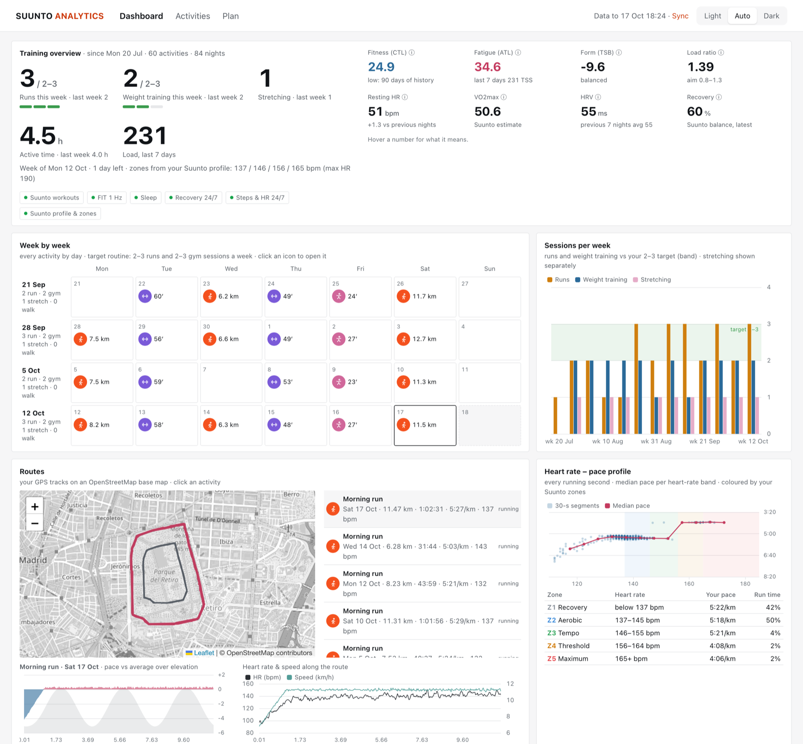

# Suunto Analytics

Ask Claude about your own Suunto watch data — workouts, sleep, recovery, training load — from a local database,
plus a dashboard to see it all in one place.


*The dashboard running on the [synthetic demo data](#quick-start): an invented athlete training in Madrid's Retiro park.*

> **Disclaimer.** Not affiliated with or endorsed by Suunto Oy. This project talks to Suunto's backend through
> [suuntool](https://github.com/tajchert/suuntool), an unofficial community tool. It is for personal and experimental
> use only and may violate Suunto's terms of service — **use it at your own risk.** You are responsible for your own
> account and data. The software is provided "as is", without warranty of any kind.

## Why
I train with a Suunto Race and there was no way to plug Suunto data into Claude. I wanted to ask questions across
all my data ("is my easy pace improving at the same heart rate?", "how does sleep relate to my
load this month?") and get a training-load view the app doesn't give me. Suunto's official API needs an approved
partner application, so this works locally on top of the unofficial access instead, and treats that access carefully.

## What it does
- **Sync**: incremental, throttled download of workouts (with 1 Hz FIT recordings), sleep, recovery and 24/7 activity
  into SQLite on your machine.
- **MCP server**: 13 read-only tools for Claude Desktop / Claude Code — activity lists and detail, HR zones, sleep,
  daily summaries, trends, fitness/fatigue/form (CTL/ATL/TSB), ACWR, efficiency, weekly digest, and a guarded `run_sql`.
- **Dashboard**: a local web app with weekly routine tracking, load and recovery panels, per-activity charts with a
  synced crosshair, routes map and a workout planner.

## Quick start
Try it without a watch or a Suunto account: this builds 12 weeks of invented data (runs around Madrid's Retiro park,
gym, sleep, recovery) and opens the dashboard.
```
uv sync
uv run python scripts/make_demo_db.py
SUUNTO_DATA_DIR=demo-data uv run suunto-app
```
To use your own data, see [Run it](#run-it).

## Stack and architecture
```
suuntool (your Suunto account)
   │  serial, throttled calls; raw responses cached in data/raw/
   ▼
parsers ──► SQLite (data/suunto.db) ──► metrics ──┬──► MCP server (read-only, stdio) → Claude
                                                  └──► dashboard (FastAPI, 127.0.0.1) → your browser
```
- **Python 3.12**, `uv`, official `mcp` SDK, `fitdecode` for FIT files, `httpx`, `keyring`.
- **SQLite** as the single store: workouts, laps, 1 Hz records, sleep and stages, recovery, 24/7 samples, profile.
- **FastAPI + plain JavaScript** (no build step), with ECharts and Leaflet vendored so the dashboard works offline.
- Data sources sit behind one adapter interface, so the MCP and dashboard layers never know where data came from.

Full detail (tables, metric formulas, sync policy): [docs/ARCHITECTURE.md](docs/ARCHITECTURE.md).

## Technical decisions and problems solved
- **Local database instead of live API calls.** Claude queries SQLite, not Suunto. Answers are instant, work offline,
  cost few tokens (tools return compact summaries, not raw dumps), and Claude never triggers traffic to Suunto.
- **Being polite to an unofficial backend.** Every call goes through one throttled runner: one request at a time, 3–5 s apart,
  at most 60 calls per run, session reused. Any 401/403/429 starts a 24 h cooldown shared by the CLI and the
  dashboard, so a mistake can't turn into hammering the server.
- **Re-parse without re-downloading.** Raw responses are cached locally, so `suunto reparse` rebuilds every table after
  a parser fix without contacting Suunto.
- **HR zone limits the files don't store.** FIT files record time per zone but not the boundaries, so they are
  inferred from the second-by-second heart rate.
- **Quirks in the data.** Wellness heart rate arrives in Hz (×60 → bpm), and running cadence in FIT is per leg (×2 →
  steps/min). Workout types come from FIT sub-sports, so gym and stretching sessions are told apart.
- **Letting an LLM run SQL safely.** `run_sql` opens the DB with `mode=ro` and `query_only`, and installs a SQLite
  *authorizer* that allows a single `SELECT` and denies writes, `PRAGMA`, `ATTACH` and the GPS columns at the engine
  level rather than by string matching. Rows, output size and run time are capped.
- **Dashboard hardening, even on localhost.** Binds to 127.0.0.1, rejects unknown `Host` headers (DNS rebinding),
  checks `Origin` on the sync endpoint, sends a strict CSP, and escapes all text from the database.
- **Metrics from first principles.** CTL/ATL as exponentially weighted TSS (42/7 days), form from the previous day's
  values, ACWR, efficiency factor, and sleep consistency. Formulas are documented and covered by tests.

## Privacy
Everything stays on your machine. Synced data (`data/`, including the SQLite DB, raw downloads and FIT files with GPS)
is git-ignored and never uploaded by this project. Your Suunto password is never stored by this project (optionally the
macOS Keychain holds it); the session token belongs to suuntool. The MCP server never exposes GPS. Map tiles come
from OpenStreetMap (loading them shares the map area with the tile server); everything else works offline.

## Run it
Tested on macOS. Linux should work; Windows is untested (suuntool supports macOS and Linux only).

1. `uv sync`
2. Install the community `suuntool` binary yourself (unofficial; may violate Suunto's ToS — use at your own risk).
   Verify its checksum, then point to it: `export SUUNTOOL_BIN=~/suuntool-bin/suuntool`
   (also auto-detected on PATH or at `~/suuntool-bin/suuntool`).
3. `uv run suunto login` — password is prompted (never echoed or stored by this project). Optionally save it
   in the macOS Keychain so an expired session is renewed silently (once per run).
4. `uv run suunto sync` — first run fetches 7 days (`--days N`, max 30); later runs are incremental.
   `uv run suunto status` shows the last data per stream and any cooldown.
5. `uv run suunto-app` — opens the dashboard at http://127.0.0.1:8790 (`--port N`, `--no-browser`). Its **Sync**
   button runs the same sync, at most once every 15 minutes.

Tests: `uv run pytest -q`

### Connect Claude
Claude Code (run once, from any directory):
```
claude mcp add suunto -e SUUNTO_DB=/path/to/suunto-analytics/data/suunto.db -- uv run --project /path/to/suunto-analytics suunto-mcp
```
Claude Desktop (`~/Library/Application Support/Claude/claude_desktop_config.json`):
```json
{"mcpServers": {"suunto": {"command": "uv",
  "args": ["run", "--project", "/path/to/suunto-analytics", "suunto-mcp"],
  "env": {"SUUNTO_DB": "/path/to/suunto-analytics/data/suunto.db"}}}}
```
The server reads the database live, so new syncs show up without a restart. Start with *"give me an overview of my
Suunto data"*.

## Credits
- [suuntool](https://github.com/tajchert/suuntool) by **tajchert** (MIT) — the Suunto login, workout, wellness and
  FIT export access this project relies on. This project does not bundle it; install it yourself.
- [ha-suunto](https://github.com/MichalZaniewicz/ha-suunto) by MichalZaniewicz — reference for the data model.
- Vendored, unmodified: [Apache ECharts](https://echarts.apache.org) 5.5.1 (Apache-2.0), [Leaflet](https://leafletjs.com) 1.9.4 (BSD-2-Clause).
  Map tiles © [OpenStreetMap](https://www.openstreetmap.org/copyright) contributors.

## License
MIT — see [LICENSE](LICENSE). Vendored libraries keep their own licenses (`frontend/vendor/LICENSE-*.txt`).
